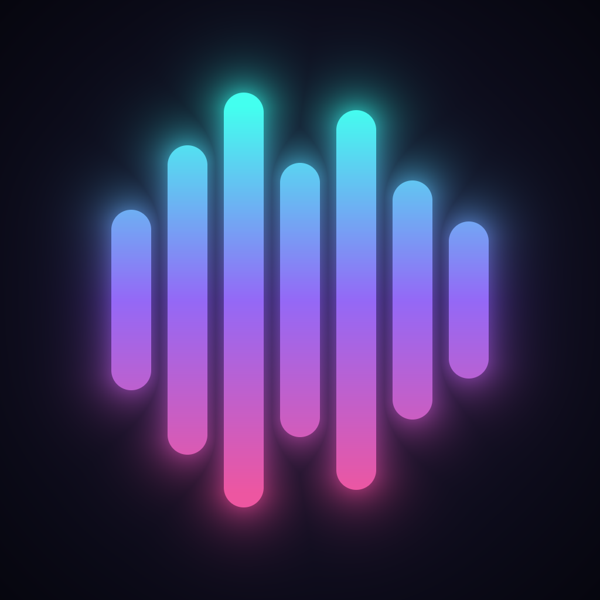

<p align="center">
  
</p>

<h1 align="center">TidalPresence</h1>

<p align="center">Your TIDAL music in Discord, your way.</p>

TidalPresence is a Discord Rich Presence plugin for [TidaLuna](https://github.com/Inrixia/TidaLuna). It shows what you're listening to on TIDAL in your Discord status, and you decide exactly what that status says.

## Install

1. Install [TidaLuna](https://github.com/Inrixia/TidaLuna).
2. In TIDAL, open **Settings → Luna → Plugin Store**.
3. Paste this into **Install from URL**:

   ```
   https://github.com/BaeHyolyn/tidal-presence/releases/latest/download/store.json
   ```

4. Install **TidalPresence** from the store that appears.

If you use another Discord status plugin, disable it first so Discord doesn't get two statuses.

When TidalPresence loads, Luna asks for file system access. The plugin needs it to find Discord's local connection, so allow it.

## Features

- **Custom text** for the status line, the line under the track title, and the album cover hover text.
- **Tags** you can use in any of those texts:

  | Tag | Example |
  |---|---|
  | `{track}` | Bohemian Rhapsody |
  | `{artist}` | Queen |
  | `{album}` | A Night at the Opera |
  | `{year}` | 1975 |
  | `{duration}` | 5:55 |
  | `{trackNumber}` | 11 |
  | `{quality}` | Max, HiFi, High or Low (what's actually playing) |
  | `{lyric}` | The lyric line playing right now (songs with synced lyrics) |
  | `{nextLyric}` | The lyric line coming next |
  | `{nextLyric2}` | The lyric line after that |
  | `{playlist}` | Gym Mix (the playlist, mix or album you're playing from) |

- **Live lyrics**: put `{lyric}` in any text and your status follows the song, line by line. The whole song is planned up front so Discord's update limit is spent on the lines that stay on screen longest.
- **Two and three-line karaoke**: the current line on top and the next ones below. With 3 lines, the whole card is lyrics and the header keeps the song and artist.
- **Lyrics timing**: send lines up to 1.2 seconds early to make up for Discord's delay.
- **Lyrics style**: 𝐛𝐨𝐥𝐝, 𝑖𝑡𝑎𝑙𝑖𝑐 or sᴍᴀʟʟ ᴄᴀᴘs lyrics (Discord can't show colors). Accents and ñ are kept.
- **Style presets**: Minimal, Detailed, Audiophile, Karaoke, Karaoke 2 lines and Karaoke 3 lines, in one click.
- **Small icon**: artist picture, an audio quality badge (MAX, HIFI, HIGH, LOW) or nothing.
- **Time display**: progress bar, elapsed time only, or hidden.
- **Private mode**: hide your status with one switch, or never show certain artists.
- **Music videos** show as "Watching" with the video thumbnail.
- **Buttons**: "Listen on TIDAL", plus "View Album", or "View Playlist" when you're playing a public playlist.
- **Settings in English and Spanish**, following TIDAL's language.

Example status text: `{track} by {artist} · {album} on TIDAL`

## Fast and private

- **Instant updates.** Your status is built from data TIDAL already has loaded, so it appears right away.
- **Only TIDAL lookups, and only when needed.** The artist picture (when TIDAL didn't load it, like songs played from a playlist) and synced lyrics (only if you use `{lyric}`) are fetched from TIDAL in the background, once, and remembered.
- **No duplicate updates.** Identical updates are skipped, and quick bursts of events like seeking are merged into a single update. Live lyrics use Discord's full budget of 5 updates per 20 seconds: quick lines go out right away, and when the budget runs out the line playing at that moment is sent.
- **Reconnects automatically** if Discord is closed or restarted.
- **Nothing goes to third parties.** The plugin only talks to Discord on your PC and to TIDAL itself. Your TIDAL session is only used by TidaLuna to talk to TIDAL, never sent anywhere else.

## Build

```sh
pnpm install
pnpm run build
pnpm test
```

The plugin and `store.json` are written to `dist/`.

## Releasing

Every pull request is built and tested automatically. To publish a new version, push a tag from `main`:

```sh
git tag v1.2.2
git push origin v1.2.2
```

GitHub Actions builds the plugin from that tag and publishes the release, and users get it the next time they restart TIDAL.

## License

[AGPL-3.0](LICENSE). Created by [BaeHyolyn](https://github.com/BaeHyolyn). Originally derived from DiscordRPC by Inrixia.
